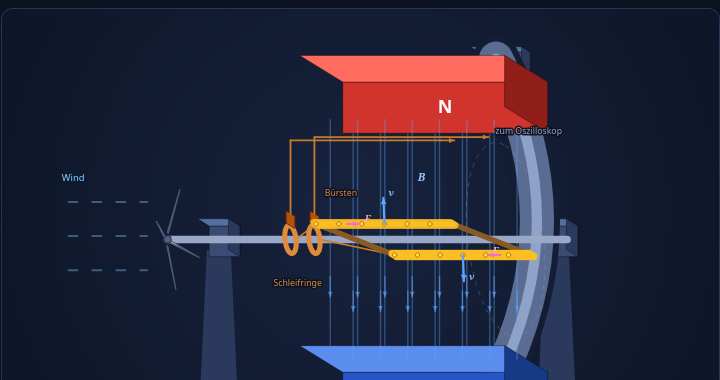
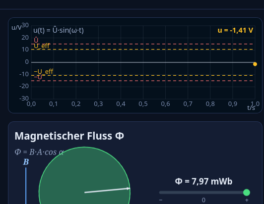

# Wechselstromerzeugung

**Wie aus einem drehenden Drahtrahmen im Magnetfeld eine sinusförmige Spannung entsteht – und warum daraus unser Stromnetz wird.**

Interaktiv ausprobieren: **lschink.github.io/wechselstrom-simulation**

## 1. Der Aufbau: ein Generator im Kern

{width=88%}

Die Simulation zeigt den einfachsten Wechselstromgenerator: Ein **Hufeisenmagnet** erzeugt zwischen seinem Nordpol (oben, rot) und Südpol (unten, blau) ein homogenes Feld – die Feldlinien verlaufen von N nach S. Dazwischen dreht sich ein rechteckiger **Leiterrahmen** (die Spule) mit konstanter Winkelgeschwindigkeit ω um eine horizontale Achse. Am linken Achsende treibt eine **Windmühle** die Drehung an – symbolisch für jeden beliebigen Antrieb von der Turbine bis zum Fahrraddynamo; die Windgeschwindigkeit bestimmt die Drehzahl. Die beiden Spulenenden führen über **Schleifringe und Bürsten** zum Oszilloskop, das die entstehende Spannung live anzeigt.

## 2. Der magnetische Fluss durch die Spule

Entscheidend ist, wie viel Feld die Spule „einfängt“ – der magnetische Fluss:

> **Φ = B · A · cos(α)**

mit Flussdichte B, Spulenfläche A und Drehwinkel α. Liegt die Spule flach zwischen den Polen, ist die durchsetzte Fläche maximal (Φ maximal). Steht sie quer, schlüpfen keine Feldlinien durch sie hindurch – der Fluss ist null. Das Fluss-Diagramm der Simulation zeigt diese Projektionsfläche während der Drehung: ein Kreis, der zur Ellipse wird und wieder zurück.

## 3. Wie aus Bewegung Spannung wird

Bewegt sich ein Leiter mit der Geschwindigkeit **v** senkrecht zu den Feldlinien **B**, wirkt auf die Elektronen im Leiter die **Lorentz-Kraft F = q · (v × B)** (UVW-Regel). Dabei stehen **B, v und F immer paarweise senkrecht aufeinander** – die Kraft zeigt also nicht in Bewegungsrichtung, sondern quer dazu, entlang des Drahts. Die Simulation zeigt die Kraft als pinke Pfeile:

- In der **vorderen** Leiterseite werden die Elektronen in die eine Richtung entlang des Drahts geschoben, in der **hinteren** in die entgegengesetzte.
- Die **gelben Punkte** in der Simulation sind Elektronen, die **F-Pfeile** zeigen ihre Bewegungsrichtung; der **technische Strom** (Strompfeil-Richtung) fließt jeweils entgegengesetzt.
- Die Kräfte wirken auf beiden Seiten in **entgegengesetzte Richtungen** (die Geschwindigkeiten v sind es auch) – genau deshalb treiben sie die Elektronen **im Kreis** wie zwei in Reihe geschaltete Batterien, und ihre Spannungen addieren sich.
- Es entsteht eine **Ladungstrennung** – die getrennten Ladungen erzeugen eine Spannung an den Spulenenden.
- Nur die beiden **langen Seiten** der Spule tragen bei (die „aktiven“ Leiter); die kurzen Stege bewegen sich so, dass ihre Kräfte keine Spannung um die Spule herum liefern.

Fasst man die Wirkung aller Windungen zusammen, ergibt sich das **Induktionsgesetz**:

> **U_ind = −N · dΦ/dt**

Jede der N Windungen fügt dieselbe Spannung hinzu – die Spannung wächst also proportional zur Windungszahl. Das Minuszeichen (Lenzsche Regel) bedeutet: Die induzierte Spannung arbeitet der Flussänderung entgegen.

## 4. Warum die Spannung sinusförmig ist

Die Spule dreht sich gleichförmig, also ist Φ(t) = B·A·cos(ωt). Die Spannung ist die zeitliche Ableitung des Flusses:

> **u(t) = N·B·A·ω · sin(ωt) = Û · sin(ωt)**

{width=88%}

Zwei Momente sind auf dem Oszilloskop gut zu erkennen – die Simulation markiert sie farbig:

- **Spannung null** (gelb): Die Leiter bewegen sich gerade **parallel** zu den Feldlinien. Der Fluss ist maximal, aber seine **Änderung** ist null – u = 0.
- **Spannung maximal** (grün): Die Leiter schneiden die Feldlinien **senkrecht**. Hier ändert sich der Fluss am schnellsten – u = ±Û.

Pro Umdrehung entsteht genau **eine Periode**: Die Frequenz der Wechselspannung ist gleich der Drehzahl der Spule, f = n/60. Schnellerer Wind → höhere Drehzahl → höhere Frequenz.

## 5. Scheitelwert und Effektivwert

Zwei Kennwerte beschreiben die Wechselspannung:

- **Scheitelwert Û = N·B·A·ω** – der Maximalwert der Kurve.
- **Effektivwert U = Û/√2 ≈ 0,707·Û** – der Wert, der an einem Widerstand dieselbe Wärmeleistung erzeugt wie eine Gleichspannung gleicher Höhe.

Deshalb sagt man „das Netz hat 230 V“: Das ist der Effektivwert. Der Scheitelwert liegt bei etwa **325 V**.

## 6. Die Formeln im Überblick

| Größe | Formel | Bedeutung |
|---|---|---|
| Fluss | Φ = B·A·cos(α) | durch die Spule tretender Feldfluss |
| Induktion | U_ind = −N·dΦ/dt | jede Windung zählt mit |
| Spannung | u(t) = Û·sin(ωt) | reine Sinusform |
| Scheitelwert | Û = N·B·A·ω | maximal mögliche Spannung |
| Effektivwert | U = Û/√2 | „gleichwertige“ Gleichspannung |
| Frequenz | f = n/60 = ω/2π | gleich der Drehfrequenz |

## Zum Mitnehmen

- Ein drehender Leiterrahmen im Magnetfeld ändert ständig seinen Fluss → das Induktionsgesetz erzeugt daraus Spannung.
- Die Spannung ist sinusförmig, weil sich die durchsetzte Fläche mit cos(ωt) ändert und die Spannung deren Ableitung ist.
- Größere Flussdichte, mehr/größere Windungen und höhere Drehzahl erhöhen die Spannung; die Drehzahl allein bestimmt die Frequenz.
- Schleifringe und Bürsten leiten den Wechselstrom ab, ohne dass sich Leitungen verdrehen – so funktioniert jeder Generator vom Modell bis zum Kraftwerk.

---

*Simulation und dieses Blatt: **lschink.github.io/wechselstrom-simulation** · Interaktive HTML-Simulation, läuft offline im Browser.*
